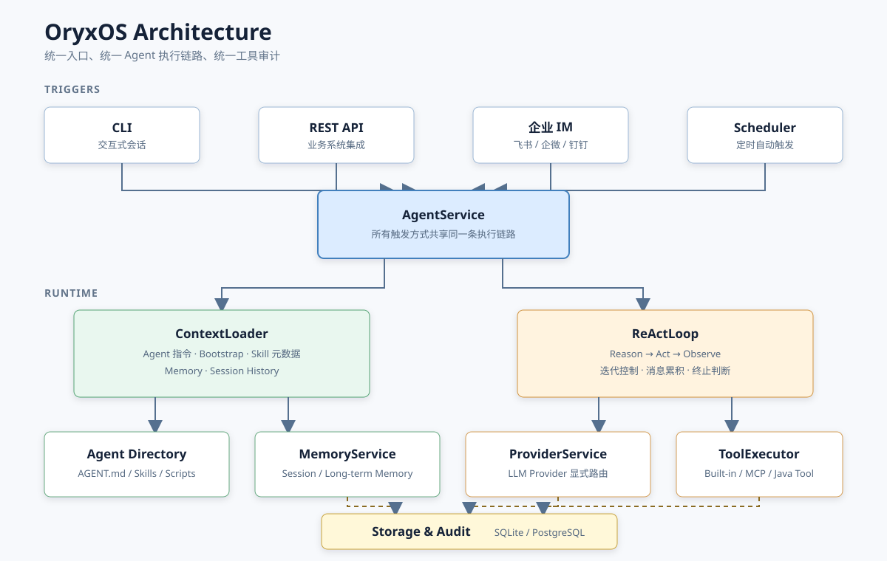

<a id="top"></a>

<div align="center">
  
  <h1>OryxOS</h1>
  <p><strong>Java 原生的企业级 Agent OS</strong></p>
  <p>在企业自己的基础设施中，统一运行、连接和治理业务 Agent。</p>
  <p>
    <a href="#status"></a>
    <a href="#technology"></a>
    <a href="#technology"></a>
    <a href="#build"></a>
  </p>
  <p>
    <a href="#overview">项目介绍</a> ·
    <a href="#features">核心能力</a> ·
    <a href="#agent-definition">定义 Agent</a> ·
    <a href="#architecture">架构</a> ·
    <a href="#modules">模块</a> ·
    <a href="#roadmap">路线图</a> ·
    <a href="#documentation">文档</a> ·
    <a href="#contributing">参与贡献</a>
  </p>
</div>

> [!IMPORTANT]
> OryxOS 目前处于开发预览阶段。Maven 14 模块、Provider、ReAct、CLI、持久化审计和 Tool 运行时已有可执行实现；Memory、完整 Web 管理面、多渠道与治理能力仍在建设中，当前没有可安装的正式版本。

<a id="overview"></a>

## 项目介绍

OryxOS 是一个面向企业私有化部署的 Java Agent OS。它为多个业务 Agent 提供统一的模型接入、ReAct 执行、记忆、工具、渠道、调度、Web API 和审计能力。业务方通过一个目录定义 Agent，无需为每个场景重复开发一套 Agent 后端。

OryxOS 计划部署在企业自己的服务器或 Kubernetes 集群中，适合以下场景：

- 数据、凭证和执行记录需要留在企业内部。
- Agent 需要接入现有 ERP、CRM、CMDB、知识库和监控系统。
- 企业希望复用 Java/Spring 运维、监控和安全体系。
- 多个 Agent 需要共享模型、工具、渠道、记忆和审计基础设施。

OryxOS 位于 Spring AI 等开发框架之上。它不是可视化工作流平台，也不是托管式 Agent SaaS；它交付的是一个可以由企业掌控的 Agent 运行底座。

<a id="features"></a>

## 核心能力

| 能力 | 解决的问题 | 核心设计 |
| --- | --- | --- |
| **LLM Provider** | 如何切换云端或本地模型 | 统一接口、显式 Provider 路由、Agent 与供应商解耦 |
| **ReAct Loop** | Agent 如何自主完成多步骤任务 | 运行时控制思考、执行、观察和终止，不依赖框架自动执行 Tool |
| **Memory** | 如何跨会话保存状态和偏好 | 会话记忆、长期记忆和可扩展的检索后端 |
| **Tool** | Agent 如何操作真实系统 | 内置 Tool、MCP Server、Java `@Tool` 和统一审计 |
| **Web Service** | 现有业务系统如何调用 Agent | REST API、统一响应、Session 与系统状态接口 |

CLI、企业 IM 和定时任务作为不同触发入口，最终复用同一条 `AgentService` 执行链路。

<a id="agent-definition"></a>

## 定义 Agent

一个 `.oryxos/agents/<name>/` 目录就是一个业务 Agent。`AGENT.md` 的 YAML frontmatter 描述运行配置，Markdown 正文描述 Agent 的职责和工作方式。

```text
.oryxos/
├── agents/
│   └── daily-weather/
│       ├── AGENT.md
│       ├── skills/
│       │   └── digest-format.link
│       ├── scripts/
│       └── REFERENCE.md
├── skills/
│   └── digest-format/
│       └── SKILL.md
├── MEMORY.md
└── oryxos.db
```

示例 `AGENT.md`：

```markdown
---
name: daily-weather
provider: deepseek
tools:
  - http_get
  - notify
schedules:
  - key: morning-weather
    cron: "0 0 8 * * *"
    zone: Asia/Shanghai
    message: 查询今天的天气，生成穿搭建议并发送通知。
---

# 每日天气助手

查询指定城市当天的天气，根据温度、降水和风力生成简洁的穿搭建议，
然后发送到配置的通知渠道。
```

公共 Skill 位于 `.oryxos/skills/<name>/`。Agent 通过自身 `skills/` 下的普通 UTF-8 `.link` 相对引用文件选择可见 Skill；它不是操作系统软连接。运行时只预载 Skill 的名称、描述和已校验路径，正文与附属资源由 Agent 按需读取。

### 定时任务核心能力

应用启动时会读取所有已加载 Profile 的 `schedules`，按每条规则声明的 cron 和显式时区动态注册，不使用写死业务规则的 `@Scheduled`。任务身份由 `(Agent name, schedule key)` 稳定派生，因此修改 cron、时区或消息不会改变身份；触发时固定使用 `channel=scheduler`、`user=scheduler` 的确定性 Session，并复用与 CLI、HTTP 相同的 `AgentService`、ReAct、Tool 和审计链路。

同一 Profile 的所有规则在单个 JVM 内共享互斥锁：已有任务运行时，后续触发立即跳过且不排队；不同 Profile 可由 4 线程调度池并行执行。执行异常会被当前回调隔离，后续触发仍可继续。

调度定义来自 `AGENT.md`。SQLite 持久化启停、计数、上次结果和执行历史。重启时按文件重新注册并计算下次触发时间，移除定义后旧历史仍可按稳定 ID 查询。停用会跳过自动触发，手动补跑仍可执行。两种触发共享 60 秒执行上限，同一 Profile 正在执行时跳过重叠请求。

管理台 `/console/` 的「定时任务」页提供列表、立即执行和启停。新版接口使用列表返回的 `scheduleId`，响应沿用 `ApiResponse`。

| 方法 | v2 路径 | 用途 |
| --- | --- | --- |
| GET | `/api/v2/schedules` | 查询活动任务及状态 |
| GET | `/api/v2/schedules/{scheduleId}/executions` | 查询执行历史，含退役任务 |
| POST | `/api/v2/schedules/{scheduleId}/run` | 立即执行一次 |
| PUT | `/api/v2/schedules/{scheduleId}` | 传入 `{"enabled": false}` 或 `{"enabled": true}` |
| POST | `/api/v2/agents/{profileName}/schedules/{key}/run` | 按 Agent 和配置键补跑 |

v1 兼容 `GET /api/v1/schedules`、`GET /api/v1/schedules/{id}/executions`、`POST /api/v1/schedules/{id}/run` 和 `PUT /api/v1/schedules/{id}`。v1 的 `{id}` 使用任务配置键。跨 Agent 同键时，单任务操作返回 HTTP 409。配置键含斜杠等路径分隔符时，使用 v2 的稳定 ID 路由。

#### Demo 前置配置

1. 在独立测试工作区的 `application.yaml` 设置 `oryxos.http.allowed-domains`。添加天气源 `api.open-meteo.com`、实际 webhook 的域名，以及通过 `http_get` 取新闻时使用的新闻源域名。默认文件与命令白名单无需扩大。
2. 用现有通知渠道注册接口配置测试渠道，Agent 正文只写渠道名称。Agent 的 `tools` 显式声明所需的 `http_get`、`notify` 或 `save_memory`。默认策略允许这些内置工具，HTTP 与通知仍需通过域名白名单。凭证通过环境变量或独立本地配置加载。
3. 按上文示例在测试 `AGENT.md` 的 `schedules` 设置 cron、`Asia/Shanghai` 和消息。使用新闻 MCP 时，在 `mcp_servers.yaml` 声明服务并用 `oryxos tool list` 核对工具注册。
4. 记录 Demo 偏好并查询记忆。补跑验证接收端送达，再重启服务并核对会话、任务状态和历史。无密钥测试及真链路运行命令见[第 28 节验收指南](specs/013-scheduled-task-operations/quickstart.md)。

<a id="architecture"></a>

## 架构



架构遵循以下原则：

- Spring AI Alibaba 负责模型协议适配和 Tool Schema 生成，ReAct 循环由 OryxOS 实现。
- Spring AI 自动工具执行保持关闭，所有工具由 `ToolExecutor` 统一调度和审计。
- Agent 目录是运行定义和上下文来源，不是可执行 Tool，也不会被解析成固定工作流。
- CLI、HTTP、企业 IM 和定时任务复用 `AgentService`，入口层只负责协议与消息适配。
- 核心阶段的 Sandbox 是应用层白名单；容器或 MicroVM 级隔离属于后续能力。

详细的模块边界、数据模型与调用流程参见[技术方案](docs/TechnicalSolution.md)。

<a id="modules"></a>

## 模块结构

根目录的 Maven 聚合工程包含以下 14 个模块：

| 模块 | 职责 |
| --- | --- |
| `oryxos-core` | 核心契约、Agent 上下文和运行时编排 |
| `oryxos-provider` | 模型接入与 Provider 路由 |
| `oryxos-memory` | 会话记忆与长期记忆门面 |
| `oryxos-tool` | 工具注册、执行、MCP 与 Sandbox |
| `oryxos-storage` | 数据源、持久化实现与数据库迁移 |
| `oryxos-web` | REST API、统一响应与 OpenAPI |
| `oryxos-channel-cli` | 终端消息渠道适配 |
| `oryxos-cli` | Picocli 命令入口 |
| `oryxos-boot` | Spring Boot 启动与依赖装配 |
| `oryxos-persona` | 内置及自定义人格模板 |
| `oryxos-knowledge` | 知识解析、索引与检索 |
| `oryxos-channel-feishu` | 飞书渠道适配 |
| `oryxos-channel-wecom` | 企业微信渠道适配 |
| `oryxos-channel-dingtalk` | 钉钉渠道适配 |

<a id="technology"></a>

## 技术栈

| 领域 | 技术 |
| --- | --- |
| 语言与运行时 | Java 21 |
| 应用框架 | Spring Boot 3.5、Spring MVC、Virtual Threads |
| LLM 接入 | Spring AI Alibaba |
| 持久化 | SQLite、PostgreSQL、Spring Data JPA、Flyway |
| 命令行 | Picocli |
| 工具协议 | MCP、Spring AI Tool Schema |
| API 文档 | OpenAPI 3、springdoc-openapi |
| 构建系统 | Maven 多模块 |

具体版本和模块依赖关系以根目录 `pom.xml` 及各模块 POM 为准。

<a id="status"></a>

## 项目状态

- [x] Agent OS 行业调研与项目定位
- [x] 核心需求、非功能需求和验收标准
- [x] 技术选型、模块边界和关键流程设计
- [x] AI 辅助开发实施指南
- [x] Maven 14 模块工程骨架、模块依赖和启动占位代码
- [x] Java 21 与 Maven 构建基线
- [x] 核心运行时契约与实现
- [x] 首个可运行的 Provider + ReAct + CLI 链路
- [x] 统一 ToolRegistry、11 个基础工具、Java `@Tool`、MCP stdio/SSE 与应用层 Sandbox
- [ ] 可供试用的预览版本

> [!NOTE]
> 当前实现仍在首个预览版本前，公开 API、配置和命令可能调整。文档只把已有自动化证据覆盖的能力标记为完成；真实外网、真实 MCP server 和真实凭证调用需部署者单独验证。

<a id="build"></a>

## 构建

环境要求：

- JDK 21
- Maven 3.6.3 或更高版本

在项目根目录使用 Maven Wrapper 执行（Windows 使用 `mvnw.cmd`）：

```bash
./mvnw clean package
```

该命令编译并打包 Maven 聚合工程中的 14 个模块。完整 CLI 与 Spring 运行时统一由 Boot exec JAR 提供：

```bash
java -jar oryxos-boot/target/oryxos-boot-0.1.0-SNAPSHOT-exec.jar --help
java -jar oryxos-boot/target/oryxos-boot-0.1.0-SNAPSHOT-exec.jar --version
```

当前提供 `init`、`status`、`chat`、`serve`、`gateway`、四条 `profile` 命令，以及 `provider/tool/session list`，共 12 条业务命令。工作区按 `-Doryxos.root` → `ORYXOS_ROOT` → 当前目录 `.oryxos/` 解析；`profile delete` 会归档整个 Agent 目录，不做永久删除。完整用法见[中文 CLI 参考](website/zh/docs/cli.md)。

调试 Agent 主流程时，可在外部配置中显式声明 `type: MOCK`、`model: mock-memory`，并让测试 Agent 绑定 `save_memory`。输入 `记住：<事实>` 会经正式的 AgentService、ReAct、Tool、Memory、Session 与审计链运行两轮，不需要 API Key 或公网；它不代表真实模型协议和质量验证。管理台位于 `/console/`，`GET /api/v1/sessions` 可返回最近 100 条安全会话摘要用于对账。

启动现有 HTTP 服务：

```bash
java -jar oryxos-boot/target/oryxos-boot-0.1.0-SNAPSHOT-exec.jar serve --port 8080
```

启动完成后访问 [http://localhost:8080](http://localhost:8080) 查看 OryxOS 项目首页，API 文档位于 [http://localhost:8080/swagger-ui/index.html](http://localhost:8080/swagger-ui/index.html)。

当前 Web Service 提供连续 Session 的创建、发消息、查询和归档，无状态 Agent 调用，以及 Profile、Memory、Tool、Health、Info 共 10 个核心 REST 端点；统一使用包含 `code`、`message`、`data`、`timestamp` 的响应信封。详细契约见[中文 REST API 参考](website/zh/docs/api.md)。当前接口没有认证、RBAC 或限流，且会话互斥只保证单 JVM 行为，应部署在受网关和网络策略保护的可信内网。

飞书、企微和钉钉模块当前尚无可运行的渠道适配器；`gateway` 只报告实际装配的 HTTP/Channel 组件，不把模块标记类当作已实现渠道。

<a id="roadmap"></a>

## 路线图

- [x] **Project Bootstrap**：建立 Maven 14 模块工程、依赖关系和 Java 21 构建基线。
- [x] **Foundation**：实现核心契约和 Provider 抽象，跑通模型调用。
- [x] **Agent Runtime**：实现 ReAct Loop、`ToolExecutor`、12 条 CLI 命令和基础 Session。
- [x] **Tool Runtime**：实现统一注册、11 个基础 Tool、Java `@Tool`、MCP Client 和应用层 Sandbox。
- [ ] **Memory**：完成长期记忆、分区语义和 Memory Tool。
- [x] **Web API**：提供 10 个核心 REST 端点、OpenAPI、统一响应和错误映射。
- [x] **Persistence & Audit**：完成 SQLite 持久化、Flyway 迁移和调用审计。
- [ ] **Multi-Agent Runtime**：支持多 Agent、动态调度和端到端示例。
- [ ] **Enterprise Integration**：增加知识库、人格和飞书、企业微信、钉钉渠道。
- [ ] **Governance**：完善 Agent 生命周期、向量检索、SSO、多租户和 Tool Policy。

近期端到端验收场景包括每日天气、每日科技日报和每日 GitHub 日报，用于验证定时触发、Tool、Skill 渐进加载、长期记忆、通知和审计链路。

<a id="documentation"></a>

## 文档

| 文档 | 内容 |
| --- | --- |
| [行业调研](docs/IndustryResearch.md) | Agent OS 业界格局、Java 生态缺位与项目定位 |
| [需求分析](docs/DemandAnalysis.md) | 功能范围、非功能需求、数据模型和验收标准 |
| [技术方案](docs/TechnicalSolution.md) | 架构决策、模块设计、关键流程和工程结构 |
| [AI 编程指南](docs/AiProgrammingGuide.md) | 规范驱动的开发顺序和任务拆解 |
| [编码 Agent 指南](AGENTS.md) | 在本仓库执行开发任务时遵守的约束 |

文档之间出现版本差异时，产品目标以需求分析为依据，架构与明确修订的实现规则以技术方案中的最新内容为准。

<a id="contributing"></a>

## 参与贡献

OryxOS 正处于早期阶段，欢迎参与需求校对、架构讨论、接口设计、测试用例和核心模块实现。

提交贡献前请：

1. 阅读[需求分析](docs/DemandAnalysis.md)和[技术方案](docs/TechnicalSolution.md)。
2. 较大的功能先明确目标、范围和验收方式，避免实现与路线图偏离。
3. 保持改动聚焦，并为行为变化补充必要的测试和文档。
4. 确保示例不包含真实 API Key、Webhook、内部地址或业务数据。

正式的 `CONTRIBUTING.md`、Issue 模板和 Pull Request 模板将在后续补充。

<a id="security"></a>

## 安全

OryxOS 将执行模型发起的工具调用。部署时必须谨慎配置工具可见范围、文件路径、命令和网络白名单。通用 Shell 或解释器拥有 OryxOS 进程用户的权限，应用层参数限制不能替代操作系统或容器隔离。

`oryxos.file.allowed-paths` 支持额外普通目录读写：只接受存在的绝对目录，拒绝原生链接，配置修改需重启。空列表仍保留当前 Agent 读写和绑定 Skill 只读；即使授权公共 Skill 的祖先也不能访问未绑定 Skill 或写入公共 Skill，Shell 工作目录仍限当前 Agent。HTTP/Shell 空白名单默认拒绝。

授权检查可读取路径/绑定元数据，拒绝的业务操作不读取目标正文、不修改文件、不启动进程或外发请求。拒绝沿用单次审计；Shell 请求参数仅存字节数和 SHA-256，安全错误不回显目标或凭证。配置示例和课程键映射见[工具文档](website/zh/docs/tool.md#sandbox-配置)。

项目尚未建立公开安全漏洞报告渠道。在正式渠道发布前，请勿在公开 Issue 中披露真实凭证、内部地址或未修复漏洞的利用细节。

<a id="license"></a>

## 许可证

项目许可证尚未确定。在仓库加入正式 `LICENSE` 文件前，仓库内容不应被视为已经授予开源许可证下的使用、修改或分发权利。

<p align="right"><a href="#top">返回顶部</a></p>
