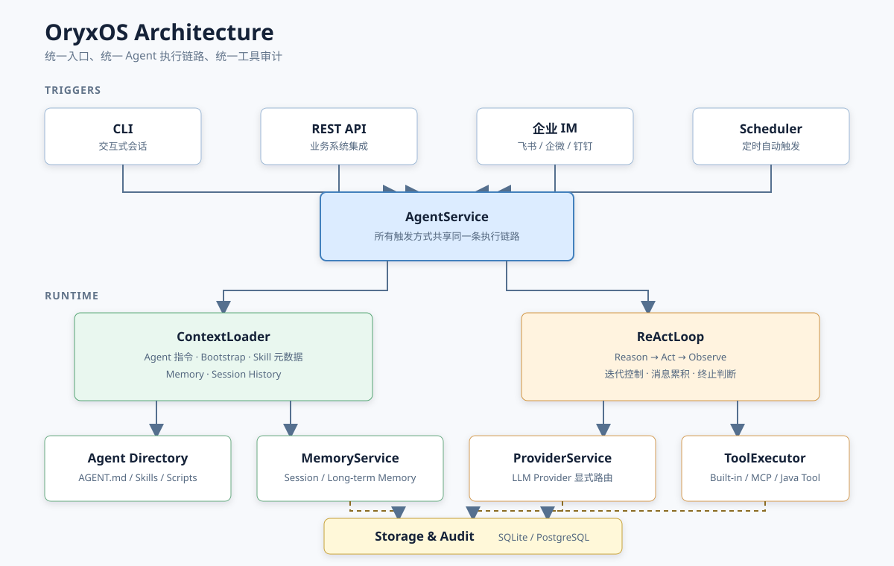

# OryxOS 项目定义

> 文档状态：项目定义基线  
> 项目版本：`0.1.0-SNAPSHOT`  
> 更新日期：2026-10-27

## 1. 文档目的

本文档统一定义 OryxOS 的项目定位、目标用户、产品边界、核心能力、架构原则、模块职责和验收方向，用于帮助产品、架构、开发、测试及社区贡献者快速形成一致理解。

本文档是四份原始设计文档的执行摘要，不替代原文：

| 文档 | 主要依据 |
| --- | --- |
| [行业调研](IndustryResearch.md) | 行业背景、Java 生态机会、项目定位与长期愿景 |
| [需求分析](DemandAnalysis.md) | 功能范围、非功能需求、数据模型与验收标准 |
| [技术方案](TechnicalSolution.md) | 架构决策、运行契约、模块边界与关键流程 |
| [AI 编程指南](AiProgrammingGuide.md) | 实施顺序、任务拆解与交付方法 |

发生冲突时，用户明确要求优先；产品目标以需求分析为依据，架构及明确修订后的实现规则以技术方案最新内容为准。

## 2. 一句话定义

**OryxOS 是面向企业私有化部署的 Java Agent OS，为多个业务 Agent 提供统一的模型调用、ReAct 执行、记忆、工具、消息接入、调度、持久化和审计基础设施。**

Agent Runtime 解决“让一个 Agent 跑起来”，OryxOS 进一步解决“让一群 Agent 在企业环境中被统一运行、接入和治理”。

## 3. 项目使命

OryxOS 希望补齐 Java 生态中 Agent 运行时底座的缺位，让企业能够：

- 在自己的服务器或 Kubernetes 环境中运行 Agent，控制数据、凭证和执行记录。
- 复用 Java、Spring、数据库、监控和安全体系，降低引入 Agent 能力的工程成本。
- 通过目录、Markdown 指令和工具配置定义业务 Agent，减少重复开发独立 Agent 后端。
- 将 ERP、CRM、CMDB、知识库、研发平台和监控系统接入统一的 Agent 执行链路。
- 在 Provider、模型和工具实现之间保持可替换性，避免被单一厂商或云平台锁定。

## 4. 目标用户

OryxOS 主要服务以下角色：

| 角色 | 核心诉求 |
| --- | --- |
| 企业平台团队 | 建设统一、私有、可审计的 Agent 基础设施 |
| Java/Spring 开发团队 | 使用熟悉的技术栈接入模型、工具和企业系统 |
| 业务系统开发者 | 通过 REST API 或消息渠道调用业务 Agent |
| Agent 设计者 | 使用 `AGENT.md`、Skill 和工具配置定义业务能力 |
| 运维与安全团队 | 管理配置、密钥、访问边界、执行记录和运行状态 |
| 开源贡献者 | 扩展 Provider、Tool、Channel、Memory 和治理能力 |

## 5. 产品边界

### 5.1 OryxOS 是什么

- 一个 Java 原生、可私有化部署的 Agent OS 运行底座。
- 一个承载多个业务 Agent 的统一运行时和共享基础设施。
- 一个通过 CLI、HTTP、企业 IM 和定时任务接收请求的 Agent 服务。
- 一个支持目录化 Agent 定义、渐进式 Skill 加载和可插拔 Tool 的扩展平台。
- 一个逐步建设企业治理能力的开源项目。

### 5.2 OryxOS 不是什么

- 不是可视化拖拽式工作流平台。
- 不是另一套通用 LLM SDK 或 Spring AI 的替代品。
- 不是托管式 Agent SaaS，不要求业务数据离开企业环境。
- 不把自然语言指令解析成固定工作流；执行路径由 Agent 在运行时决定。
- 核心阶段的应用层白名单不是容器或 MicroVM 级安全隔离。
- 当前工程骨架不是已经完成的企业级产品。

## 6. 核心概念

### 6.1 Agent

一个 `.oryxos/agents/<name>/` 目录定义一个业务 Agent，至少包含 `AGENT.md`：

```text
.oryxos/agents/daily-weather/
├── AGENT.md
├── skills/
├── scripts/
└── REFERENCE.md
```

`AGENT.md` 的 YAML frontmatter 描述运行配置，并派生运行时 `Profile`；Markdown 正文描述 Agent 的职责、约束和任务指令。Agent 目录是运行定义和上下文来源，不是一个 Tool。

### 6.2 Profile

Profile 是 Agent 的运行时配置对象，包含 Provider、模型、可见 Tool、Channel、调度和策略等信息。Profile 由 `AgentLoader` 从 `AGENT.md` frontmatter 派生，不维护另一份独立配置真相源。

### 6.3 Skill

公共 Skill 位于 `.oryxos/skills/<name>/`。`.link` 是普通 UTF-8 单行相对路径文件，由 OryxOS 解析，不依赖操作系统软连接权限。Agent 通过自身 `skills/<binding>.link` 相对引用文件选择可见 Skill，`.link` 引用文件集合是绑定关系的唯一真相源。

每轮只向模型注入已绑定 Skill 的名称、描述和本地路径；完整 `SKILL.md`、参考资料与脚本由 Agent 通过 `read_file` 按需读取。

### 6.4 Session

Session 表示一次持续对话或任务执行上下文，保存消息历史、Agent 归属、状态和时间信息，并支持持久化和跨重启恢复。

### 6.5 Tool

Tool 是 Agent 对外执行动作的标准能力。OryxOS 支持三档扩展方式：

1. 复用 Skill 与现成 MCP Server，实现零 Java 代码扩展。
2. 使用任意语言实现自定义 MCP Server。
3. 使用 Java Spring Bean 和 `@Tool` 深度集成。

所有 Tool 调用必须经过注册、可见性控制、`ToolExecutor`、Sandbox 检查和审计，不允许存在绕过统一执行链路的通道。

## 7. 五大核心能力

| 核心能力 | 职责 | 关键原则 |
| --- | --- | --- |
| Provider | 对接云端模型、本地模型和兼容协议 | Provider 名称到 `ChatModel` 显式映射，Agent 与厂商解耦 |
| ReAct Loop | 驱动 Reason、Act、Observe 和终止判断 | OryxOS 自实现循环，限制迭代、处理超时，禁用框架自动工具执行 |
| Memory | 管理会话记忆和跨会话长期记忆 | 统一门面，默认 `MEMORY.md`，区分 core 与 archival 分区 |
| Tool | 提供文件、HTTP、Shell、通知、MCP 和 Java Tool | 统一注册、执行、Sandbox 与审计 |
| Web Service | 向现有业务系统暴露 Agent 能力 | Spring MVC、统一响应结构、统一异常处理和 OpenAPI |

五项能力并非彼此孤立：Provider、Memory 和 Tool 为 ReAct Loop 提供模型、上下文和执行能力；CLI、Web、Channel 和调度器触发同一个 `AgentService` 处理链路。

## 8. 总体架构



OryxOS 采用分层单体架构，核心部署形态为一个可执行 Spring Boot JAR：

1. **接入层**：CLI、REST API、企业 IM 和定时任务负责消息进入与响应输出。
2. **Agent 层**：Agent 加载、Profile 派生、上下文加载和生命周期管理。
3. **引擎层**：`AgentService`、`PromptBuilder`、`ReActLoop` 和 `ToolExecutor` 驱动执行。
4. **能力层**：Provider、Memory、Tool、Knowledge 和 Persona 提供可组合能力。
5. **基础层**：Session、审计、配置、密钥、SQLite/PostgreSQL 和文件系统提供支撑。

关键调用链路如下：

```text
CLI / HTTP / IM / Scheduler
            │
            ▼
       AgentService
            │
            ▼
  PromptBuilder + Memory
            │
            ▼
         ReActLoop
       ┌────┴────┐
       ▼         ▼
 Provider     ToolExecutor
                  │
                  ▼
          Sandbox + Audit
```

## 9. 工程模块

OryxOS 的目标工程由 14 个 Maven 模块组成：

| 模块 | 定义职责 |
| --- | --- |
| `oryxos-core` | 核心契约、Agent 上下文、ReAct、工具执行编排和调度契约 |
| `oryxos-provider` | 模型接入、Provider 路由和 Function Calling 适配 |
| `oryxos-memory` | 统一记忆门面、长期记忆后端和记忆工具 |
| `oryxos-tool` | 内置工具、MCP Client、工具注册、Sandbox 和通知适配 |
| `oryxos-storage` | 数据源、JPA 持久化、Session、审计和数据库迁移 |
| `oryxos-web` | REST API、统一响应、异常处理和 OpenAPI |
| `oryxos-channel-cli` | 终端消息接入与交互 |
| `oryxos-cli` | Picocli 命令入口、配置和密钥加载 |
| `oryxos-boot` | Spring Boot 启动、自动配置和依赖装配 |
| `oryxos-persona` | 内置及自定义人格模板库 |
| `oryxos-knowledge` | 知识解析、切分、索引、检索和本地知识后端 |
| `oryxos-channel-feishu` | 飞书入站渠道适配 |
| `oryxos-channel-wecom` | 企业微信入站渠道适配 |
| `oryxos-channel-dingtalk` | 钉钉入站渠道适配 |

共享契约放在 `oryxos-core`，基础设施实现放在对应模块。Core 不反向依赖 Storage、具体 Provider、具体 Channel 或其他基础设施实现。

## 10. 技术基线

| 领域 | 技术选择 |
| --- | --- |
| 语言与运行时 | Java 21 |
| 应用框架 | Spring Boot 3.x、Spring MVC、Virtual Threads |
| 模型接入 | Spring AI、Spring AI Alibaba |
| Agent 引擎 | OryxOS 自实现 ReAct Loop |
| 持久化 | SQLite 默认、PostgreSQL 可选、Spring Data JPA |
| 数据库迁移 | Flyway `db/migration/{vendor}/` |
| 命令行 | Picocli |
| 工具协议 | MCP、Spring AI Tool Schema、Java `@Tool` |
| API 文档 | OpenAPI 3、springdoc-openapi |
| 构建 | Maven 多模块 |
| 部署 | 单体可执行 JAR，后续可演进至集群部署 |

具体版本以根目录 `pom.xml` 的依赖管理为准。

## 11. 运行与数据契约

### 11.1 统一执行链路

所有入口最终调用 `AgentService`。接入层只负责协议转换、路由和输入输出适配，不复制 Prompt、ReAct、Tool 或 Memory 逻辑。

### 11.2 Prompt 组装

`PromptBuilder` 统一组装 Agent 指令、Bootstrap、记忆、会话历史和可用工具。Bootstrap 与 `AGENT.md` 正文全量加载，Skill 正文按需加载。

### 11.3 记忆

- 会话历史需要持久化并支持跨重启恢复。
- 长期记忆默认存储在 `MEMORY.md`。
- Core 记忆不截断、不参与检索或向量索引。
- Archival 记忆可截断并支持关键词检索，向量索引属于渐进增强能力。
- 向量索引失败不得阻断记忆本体写入。

### 11.4 审计

`tool_invocations` 和 `llm_calls` 从核心阶段开始写入。审计记录至少能够关联 Agent、Session、调用目标、状态、耗时和错误信息，同时不得记录明文密钥。

### 11.5 调度

调度规则来自 Agent 的 `schedules`。同一任务在单进程内禁止重叠执行，重叠触发应跳过；调度定义、运行状态和执行历史分别管理，并使用稳定的 `scheduleId`。

## 12. 安全原则

- 密钥通过环境变量或独立本地配置加载，不进入 Agent 指令、仓库、日志和接口响应。
- 文件操作必须验证规范化真实路径，防止目录穿越和软连接逃逸。
- HTTP 请求和通知目标必须执行域名及地址白名单检查，并防范 SSRF。
- Shell 只允许受控命令、参数和执行时间；启用解释器等同于授予进程用户代码执行权限。
- Spring AI 自动工具执行必须关闭，Tool 只能由 `ToolExecutor` 调度。
- 核心阶段 Sandbox 是应用层防护，不将其描述为容器级安全隔离。
- 不可信代码和多租户隔离应由后续容器或 MicroVM Runner 承担。

## 13. 核心验收场景

| 场景 | 验证目标 |
| --- | --- |
| 每日天气 | 光杆 `AGENT.md` 定时查天气并通知；外部调用经过白名单和审计；支持手动补跑 |
| 每日科技日报 | Agent 绑定公共 Skill；只预载元数据；按需读取正文；跨会话记忆影响日报内容 |
| 每日 GitHub 日报 | 专用 Tool 或 MCP 执行脚本；JSON 进入上下文而脚本源码不预载；正文修改后生效 |

同时保留以下基础验收目标：

- 至少一个 Provider 能完成真实模型调用。
- ReAct 能完成多轮工具调用并正确终止，工具不会重复执行。
- Session 能持久化并跨重启恢复。
- 多个 Agent 能在同一实例中并存且配置互不污染。
- CLI、HTTP、调度和 Channel 复用同一执行链路。
- Tool 可见性、文件边界、Provider 路由和调用审计均可验证。

没有真实密钥、网络或外部服务时，应使用可控 Stub 测试，并明确标记未完成的真实端到端验证。

## 14. 实施阶段

OryxOS 按依赖关系逐步交付：

1. **Foundation**：核心契约、工程骨架和 Provider，先跑通一个模型。
2. **Agent Runtime**：ReAct Loop、基础 HTTP Tool、CLI、初始化和 Session。
3. **Memory & Plugin Tool**：稳定记忆契约、内置工具、MCP 和 Sandbox。
4. **Web Service**：通过 REST API 打通外部业务系统调用。
5. **Core Delivery**：完成持久化、审计、多 Agent、调度和端到端 Demo。
6. **Enterprise Extensions**：逐步增加 Persona、Knowledge、多 IM Channel、向量检索和治理能力。
7. **Distributed Evolution**：状态外置、多实例调度、集群高可用和分布式 Agent 协作。

14 个模块定义的是目标工程边界，不表示第一阶段必须提前填充所有实现。

## 15. 当前仓库状态

截至 2026-10-14，仓库处于**工程引导阶段**：

- 已建立 Java 21、Spring Boot 3.x 和 Maven 14 模块工程骨架。
- 已建立 `oryxos-boot` Spring Boot 主入口，可通过可执行 JAR 启动。
- 已建立 `oryxos-cli` Picocli 主入口，可通过可执行 JAR 输出版本信息。
- 已建立 README、架构图、Logo 和独立 VitePress 官网工程。
- Provider、ReAct、Memory、Tool、持久化、审计和 Channel 等核心业务实现仍待逐步完成。
- 当前没有可安装的正式版本，也不能将模块占位类视为对应能力已经交付。

## 16. 项目成功标准

OryxOS 的成功不以模块数量或接口数量衡量，而以是否形成可信的完整运行链路衡量：

1. 企业能够用一个 Agent 目录定义业务能力，并在不修改内核的情况下加载运行。
2. Agent 能通过统一 ReAct 引擎调用模型、记忆和工具，且执行过程可控制、可恢复、可审计。
3. CLI、HTTP、调度和企业消息入口能够共享同一套业务语义。
4. Provider、Tool、Channel、Memory 和 Storage 可以在稳定契约下替换或扩展。
5. 默认部署简单，同时对企业安全、持久化和后续集群演进保留清晰路径。
6. 文档、示例、配置和代码始终与实际实现状态一致。

## 17. 相关入口

- [项目 README](../README.md)
- [项目协作指南](../AGENTS.md)
- [技术方案](TechnicalSolution.md)
- [需求分析](DemandAnalysis.md)
- [独立官网说明](../website/README.md)
- [GitHub 仓库](https://github.com/winter8848123/OryxOS_Demo)
